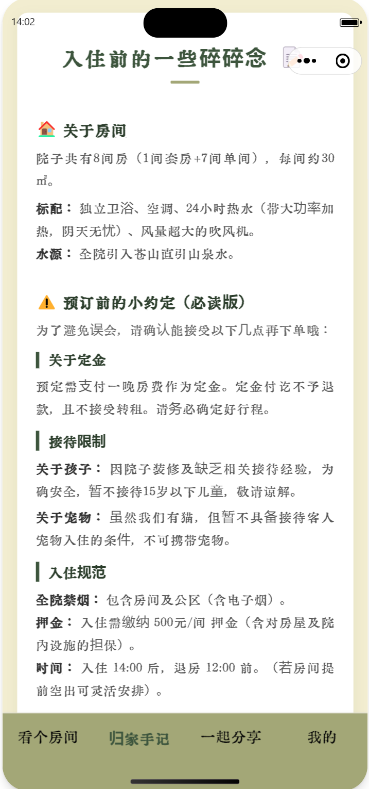
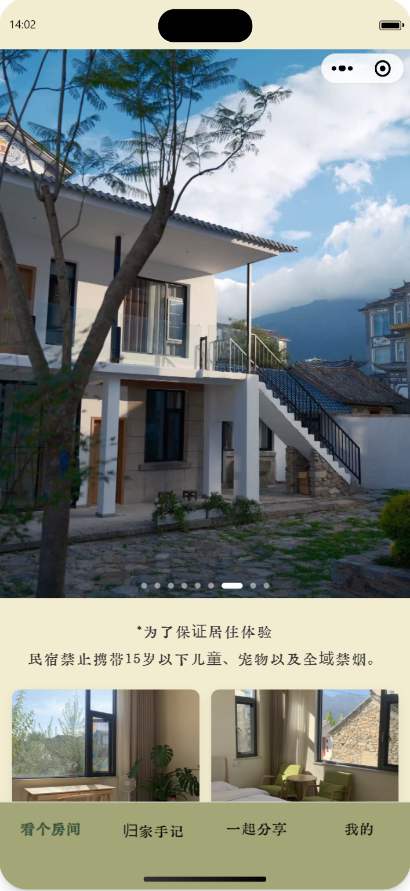

# 孟沢洲手账小程序

本项目是基于 TDesign 打造的通用页面模板进行的深度定制版本。主要用于个人手账管理，包含经过魔改的登录注册、个人中心及特色游览指南功能。

## 模版功能预览

### 游览指南 (Massage)
> **说明**：原有的 guide 页面已重构为全新的 massage 页面，作为项目的核心导览入口。

<div style="display: flex">
  
</div>

### 首页与核心功能
<div style="display: flex">
  
  
</div>


## 项目特点
- **样式升级**：全量使用 `less` 文件编写样式，不包含任何 `wxss` 文件。
- **页面魔改**：根据个人需求对 TDesign 原始组件进行了深度二次开发。
- **结构优化**：移除了冗余的 guide 页面，统一由 massage 页面承载游览指南。

## 开发预览

### 在开发者工具中预览

```bash
# 安装项目依赖
npm install

```

打开[微信开发者工具](https://mp.weixin.qq.com/debug/wxadoc/dev/devtools/download.html)，导入整个项目，构建 npm 包，就可以预览示例了。

### 基础库版本

最低基础库版本`^2.6.5`


## 贡献成员

<a href="https://github.com/TDesignOteam/tdesign-miniprogram-starter/graphs/contributors">
  
</a>

## 反馈

有任何问题，建议通过 [Github issues](https://github.com/TDesignOteam/tdesign-miniprogram-starter/issues) 反馈。

## 开源协议

TDesign 遵循 [MIT 协议](https://github.com/TDesignOteam/tdesign-miniprogram-starter/blob/main/LICENSE)。
